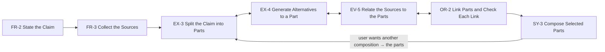

## Solution

Support this sequence of subtasks:

1. FR-2 State the Claim. The user states the claim in a first part.
2. FR-3 Collect the Sources. The user adds the sources that later subtasks can use.
3. EX-3 Split the Claim into Parts. The user and the system add parts of different kinds.
4. EX-4 Generate Alternatives to a Part. The system proposes other versions of one part.
5. EV-5 Relate the Sources to the Parts. The system links source sections to each part.
6. OR-2 Link Parts and Check Each Link. The system scores how well two linked parts fit.
7. SY-3 Compose Selected Parts. The system writes one document from the parts that the user
   selects.

## Examples

Built from the subtask Examples: the site shows one table per system, a row per subtask.
