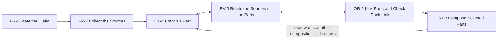

# Analysis: IdeaSynth

Source: `data-text/ideasynth.txt` (from `data/ideasynth.pdf`, 31 pages). Pu et al., "Iterative
Research Idea Development Through Evolving and Composing Idea Facets with Literature-Grounded
Feedback", CHI '25. The paper is published with author names, unlike the four other exemplars.

System section: §4 "IdeaSynth", lines 507–1036 of the text file (§4.1 walkthrough 535–818,
§4.2 canvas 820–922, §4.3 feedback methods 924–1017, §4.4 implementation 1018–1036). Study
findings about the interface: §5.3 (lines 1147–1452) and §6.1 (lines 1454–1514).

Note on the text: the recipe removes lines that hold only a number, so the top-level section
numbers ("3", "4", "5") are gone. The headings stay ("Formative Study", "IdeaSynth"). The
subsection numbers (4.1, 4.1.3 …) are readable.

## 1. Summary

- **Task:** develop an early research idea into a specific research brief (§4, §4.1.1).
- **User:** a researcher with an initial idea and some papers (§4.1.1, §5.1.1).
- **Interface:** three panels (Fig. 2): a Literature Review Panel to collect papers and get
  summaries (Fig. 3), an Idea Node Canvas of typed facet nodes in a tree (Fig. 4, Fig. 5), and a
  Research Brief Panel (Fig. 6).
- **Core loop:** split the idea into facets, generate alternatives and expansions per facet,
  link facets and check each link, then compose a selected path of facets into a brief (§4.2).
- **Grounding:** every suggestion cites only the papers that the user collected (§4.3).

## 2. Workflow

The order follows the walkthrough (§4.1). §4.2 states that the user can start with any facet
type and move between steps freely.

1. **Enter the initial idea in a node.** The user creates a "Problem Description and RQ" node and
   enters the research question (§4.1.2, Fig. 4 ①). A node has a facet type (one of four, from a
   drop-down), a title, and content (§4.2, Fig. 5 ① ②).
2. **Collect papers.** The user searches Semantic Scholar and adds papers to the collection tray.
   "Recommend papers" suggests more from the collection (§4.1.2, §4.3, Fig. 3 ① ②). The system
   cites no paper outside the collection (§4.3).
3. **Get a summary and an analysis of the collection.** A one-paragraph summary, and an analysis
   that links paper sections to the nodes on the canvas, with next-step suggestions (§4.1.2,
   §4.3, Fig. 3 ④ ⑤). Paper icons open the paper in the tray (§4.1.2). A Q&A box answers
   questions about the papers or the nodes (§4.1.4, §4.3, Fig. 3 ③).
4. **Get suggestions on one node.** "Get AI Suggestions" gives a clarifying question, an
   alternative, or an expansion, with paper references. The user toggles between them, and
   adopts one by hand or with an action button (§4.1.3, §4.3, Fig. 5 ③ ④).
5. **Generate alternatives and expansions.** From the node menu, the user generates nodes of the
   same type ("Generate Alternatives") or of another type, with an optional prompt (§4.1.3,
   §4.1.4, §4.2, Fig. 5 ⑤). A new node reads the current node and its linked nodes (§4.2). New
   nodes are colour-coded by type and linked to their origin (§4.1.4). The user deletes the
   nodes that are out of scope (§4.1.4).
6. **Link nodes and check each link.** The user links nodes. Each edge has a colour for the
   strength of the connection (red weak, green strong). It expands to a suggestion that makes the
   two nodes more coherent, which the user can adopt (§4.1.4, §4.2, Fig. 4 ④).
7. **Act on a node-level analysis.** The left menu of a node shows the paper sections that relate
   to it, with suggestions. The user drags a suggestion onto the canvas to create a chain of new
   nodes (§4.1.4, §4.3, Fig. 4 ⑤, Fig. 5 ⑥).
8. **Compose a brief.** The user selects a path of nodes and generates a research brief. The brief
   keeps the links between the facets. When the brief has focus, its nodes and edges are
   highlighted on the canvas. Several briefs can stay open in tabs (§4.1.5, §4.2, Fig. 6).
9. **Return to the canvas.** The user develops other clusters of nodes, and composes more briefs
   (§4.1.5).

## 3. Match table

### Workflows

| Pattern | Instance | Where | Fit |
|---|---|---|---|
| WF-1 Guided Candidate Search | no | not shown | Alternatives are like candidates (§4.1.4), but there are no criteria, scores, or groups |
| WF-2 Multi-Viewpoint Refinement | no | not shown | The idea develops against sources (§4.3), but no viewpoints form and no discussion takes place |
| WF-3 Decompose and Verify | partial | §4.1.2, §4.2 | The idea is split into typed parts. The parts are developed and composed, not checked against outcomes |

### Subtasks

| Pattern | Instance | Where | Fit |
|---|---|---|---|
| FR-1 State the Start and the Criteria | no | not shown | No criteria are stated |
| FR-2 State the Claim | partial | §4.1.2, §4.2, Fig. 4 ①, Fig. 5 ① ② | The user enters the idea in one node and can get a regenerated version (Fig. 5 ③). The claim is spread over nodes, not held in one frame. No before/after review (C-11) is shown |
| EX-1 Generate Candidates | partial | §4.1.3, §4.1.4, Fig. 4 ③, Fig. 5 ⑤ | Returns several nodes on the map, linked to their origin, and an optional prompt steers it. The input is one node and its neighbors, not criteria |
| EX-2 Build Contrasting Viewpoints | no | not shown | — |
| EX-3 Split the Claim into Checkable Parts | partial | §4.1.2, §4.2, Fig. 5 ① | The idea is split into typed parts on a tree. The user makes the split, and the system adds parts of other types on request. The parts are not checkable, and there is no scoped conversation |
| OR-1 Group Candidates by Criteria | no | not shown | Colour marks the facet type, not a signature |
| EV-1 Check Candidates Against Every Criterion | no | not shown | — |
| EV-2 Discuss One Question Across Viewpoints | no | not shown | — |
| EV-3 Collect Evidence for Each Part | no | not shown | — |
| EV-4 Judge Each Part Against Its Evidence | no | not shown | The edge check judges a link between two parts (§4.2). That is a different act; see Unmatched U3 |
| SY-1 Combine Partial Candidates | no | not shown | Participant N6 combined two design nodes by hand (§5.3.2). The system proposes no combination |
| SY-2 Summarize the Discussion | no | not shown | The literature summary summarizes sources, not a discussion |
| CM-1 Keep Candidates and Start the Next Round | partial | §4.1.4 | The user deletes out-of-scope nodes, and the others stay on the canvas as the next starting points. There is no separate keep view |
| CM-2 Accept or Reject Proposed Revisions | partial | §4.1.3, §4.1.4, Fig. 5 ③ ④ | The user picks one of several suggestions and adopts it, or lets the system apply it. No before/after, and the replaced text is not kept (not shown) |
| CN-1 Propose Next Steps from Open Items | partial | §4.1.2, §4.3, Fig. 4 ⑤ | The analysis proposes next steps, and dragging one creates a chain of nodes. The proposals come from a comparison of sources and parts, not from open items of a round |

### Components

| Pattern | Instance | Where | Fit |
|---|---|---|---|
| C-1 Inquiry Frame | partial | §4.2, Fig. 5 ① ② | Each node is a typed field (type, title, content). There is no single frame; the canvas is the context of every generation (§4.2, §4.3) |
| C-3 Candidate Groups | no | not shown | — |
| C-4 Persistent Structure Map | yes | §4.2, Fig. 2 ②, Fig. 4 | A canvas of nodes in a tree, each node linked to its origin. Semantic zoom hides node detail (§4.2). Kept for the session as a mind map (§4.1.5) |
| C-5 Multi-Criteria Encoding | no | not shown | — |
| C-6 Detail on Demand | partial | §4.1.4, §4.2, Fig. 5 ⑥ | Menus expand from the four sides of a node, and an edge expands to its suggestion. The detail opens on the item, not in a panel beside the overview |
| C-7 Attached Evidence | yes | §4.1.4, §4.3, Fig. 5 ③ ⑥ | Each node shows the paper sections that relate to it. Suggestions cite papers. Paper icons in the summary open the paper (§4.1.2) |
| C-8 Confidence Cue | yes | §4.2, Fig. 4 ④ | Edge colour shows the strength of each link, red to green. It scores links that the user draws too, and it measures coherence, not confidence |
| C-9 Scoped Conversation | partial | §4.1.4, §4.3, Fig. 3 ③ | The Q&A is a conversation over the whole collection, not one item. Node suggestions are scoped to a node and its neighbors (§4.2), but are one turn |
| C-10 Proposal Set | yes | §4.1.3, §4.3, Fig. 5 ③ ④ | Three kinds of suggestion per node, each with paper references. The user toggles between them and applies one |
| C-11 Reviewable Revision | no | not shown | "Regenerate Current Research Component" rewrites a node. No before/after is shown |
| C-12 Shortlist | partial | §4.1.5, Fig. 6 | The user selects nodes, and the brief is the deliverable, in its own tab. The selection is per brief, not a keep action on each item |
| C-14 Provenance Link | yes | §4.1.4, Fig. 6 | Each generated node links to the node it came from. The brief highlights the nodes it was built from. Replaced content is not kept (not shown) |
| C-17 Typed Item | partial | §4.2, Fig. 5 ① ② | Four item kinds, chosen per node from a drop-down and colour-coded. All kinds have the same two fields (title, content), not fields per kind |

**Counts.** 31 rows (3 workflows, 15 subtasks, 13 components). Yes: 5. Partial: 12. No: 14.

## 4. Unmatched

| # | Step or UI | Where | Role |
|---|---|---|---|
| U1 | Collect the sources that the system may cite: search, add, and get recommendations from the collection | §4.1.2, §4.3, Fig. 3 ① ② | Frame (also Expand). The collection bounds what every later suggestion cites (§4.3). "Frame" today means goal and criteria; a set of sources is neither |
| U2 | Branch one part: generate alternatives of the same type, or next parts of another type; prune | §4.1.3, §4.1.4, §4.2, Fig. 5 ③ ④ ⑤ | Expand |
| U3 | Link two parts; the system scores the link and proposes how to make the two parts fit | §4.1.4, §4.2, Fig. 4 ④ | Organize (also Evaluate) |
| U4 | Relate the sources to the parts: a summary, an analysis that links paper sections to parts, a Q&A, and suggestions that create new parts | §4.1.2, §4.1.4, §4.3, Fig. 3 ③ ④ ⑤, Fig. 5 ⑥ | Evaluate |
| U5 | Compose a selected path of parts into one document that keeps their links; several documents in tabs | §4.1.5, §4.2, Fig. 6 | Synthesize |

**Counts.** 5 unmatched items. Every one fits a role; U1 fits Frame loosely.

## Proposed changes

Rule numbers are the steps of Phase 3 in `.claude/commands/add-paper.md`.

**P1 New instance (rule 1; decisions 10/6 "Examples").** Add an IdeaSynth Examples line and add
IdeaSynth to `systems` in C-4, C-7, C-8, C-10, C-14. C-8 notes that the score measures
coherence of a link. Files: `patterns/C-4.md`, `C-7.md`, `C-8.md`, `C-10.md`, `C-14.md`.

**P2 Promotion (rule 2).** No single-system pattern has a "yes". Nothing moves, unless P4 option
B is chosen.

**P3 Partials, record the difference only (rule 3).** EX-1, CM-1, CM-2, CN-1, C-1, C-9, C-12: the
difference is in the Fit column above; the pattern text does not change, and IdeaSynth is not
added. Reason: each one would need its Situation or Problem changed to fit.

**P4 Partials with a text change (rule 3), for the author.**
- *FR-2.* Add IdeaSynth as an instance with no text change. Step 2 is conditional ("when later
  work implies a change"), and the MVP permits a system to lack a component of a subtask
  ("A system can lack one of them in its paper"). The Example states that no before/after is
  shown. Files: `patterns/FR-2.md`.
- *EX-3.* Option A (recommended): record the difference only; IdeaSynth's split goes into the new
  EX-4. Option B: generalize EX-3 to "Split the Claim into Parts" (drop "checkable"), and make
  step 1 "the system or the user proposes the parts". EX-3 then has two systems and moves to
  `active`. Reason for A: in IdeaSynth the user makes the split, the parts are not checkable,
  and the Problem of EX-3 ("loses which part a check applies to") does not occur.
- *C-6.* Add a variation: "the detail opens from the item itself, as a menu on one side". Add
  IdeaSynth. Files: `patterns/C-6.md`.
- *C-17.* Add a variation: "the user chooses the kind of each item from a fixed list; a colour
  marks the kind". Add IdeaSynth. Files: `patterns/C-17.md`.

**P5 New workflow (rule 4).** IdeaSynth follows none of WF-1 to WF-3. New: **WF-4 Decompose,
Vary, and Compose**, status `active`, systems IdeaSynth.
- Situation: "The user develops a rough claim into a complete statement, one part at a time."
- Problem: "In one linear document, the user develops one version of each part, and does not see
  how the parts fit together." (§3.2, §5.3.1, §5.3.4)
- Graph (main path in line order; two-way edges between neighbors):

Files: `patterns/WF-4.md`, `diagrams/WF-4.reladraw`.

**P6 New subtasks (rule 5), all `single-system`, IdeaSynth.** Next free numbers: FR-3, EX-4,
OR-2, EV-5, SY-3.

| ID | Name | Role | Steps (component) |
|---|---|---|---|
| FR-3 | Collect the Sources | Frame (also Expand) | 1 Add sources — (no component). 2 Get recommended sources — C-10 Proposal Set |
| EX-4 | Branch a Part | Expand | 1 Request branches — C-4, C-14, C-17. 2 Adopt a suggestion — C-10, C-7. 3 Prune branches — C-4 |
| EV-5 | Relate the Sources to the Parts | Evaluate | 1 Get the analysis — C-7, C-6. 2 Ask about the sources — (no component). 3 Turn a suggestion into parts — C-10, C-14 |
| OR-2 | Link Parts and Check Each Link | Organize (also Evaluate) | 1 Link two parts — C-4, C-8. 2 Strengthen a link — C-6, C-10 |
| SY-3 | Compose Selected Parts | Synthesize | 1 Select parts — C-4. 2 Get the document — C-14. 3 Keep several documents — (no component) |

Files: five new `patterns/*.md`, `single-system-patterns.md`, `pattern-language-mvp.md` (index).

**P7 Component rules (rule 6).** No new component. Three "(no component)" needs appear (FR-3 step
1, EV-5 step 2, SY-3 step 3); each occurs in one subtask, so nothing is promoted. C-10 gains FR-3,
EX-4, EV-5, OR-2; C-4 gains EX-4, OR-2, SY-3; C-14 gains EX-4, EV-5, SY-3; C-7 gains EX-4, EV-5;
C-6 gains EV-5, OR-2 (with P4); C-8 gains OR-2; C-17 gains EX-4 (with P4). No component falls
below two subtasks.

**P8 Roles (rule 7; decisions 10/6, tentative).** FR-3 fits Frame loosely: Frame is "states the
goal and the criteria", and a source set is neither. Option: widen Frame to "states the goal, the
criteria, and the material that later subtasks may use". Recommended: widen. Files:
`pattern-language-mvp.md` (Subtask roles), `glossary.md` (role).

**P9 Glossary (rule 8).** New terms, defined before use:
- **collection** — the sources that the user adds. The system cites no source outside it.
- **alternative** — an item of the same kind as another, that the system proposes beside it.
  (Not "variant", which is a copy of a procedure.)
- **composition** — a document that the system writes from parts that the user selects. It keeps
  a link to each part.
- **source** — material outside the work that the system reads: a paper, a page, or a dataset.
  Today "evidence" uses the word without a definition.

Files: `glossary.md`.
